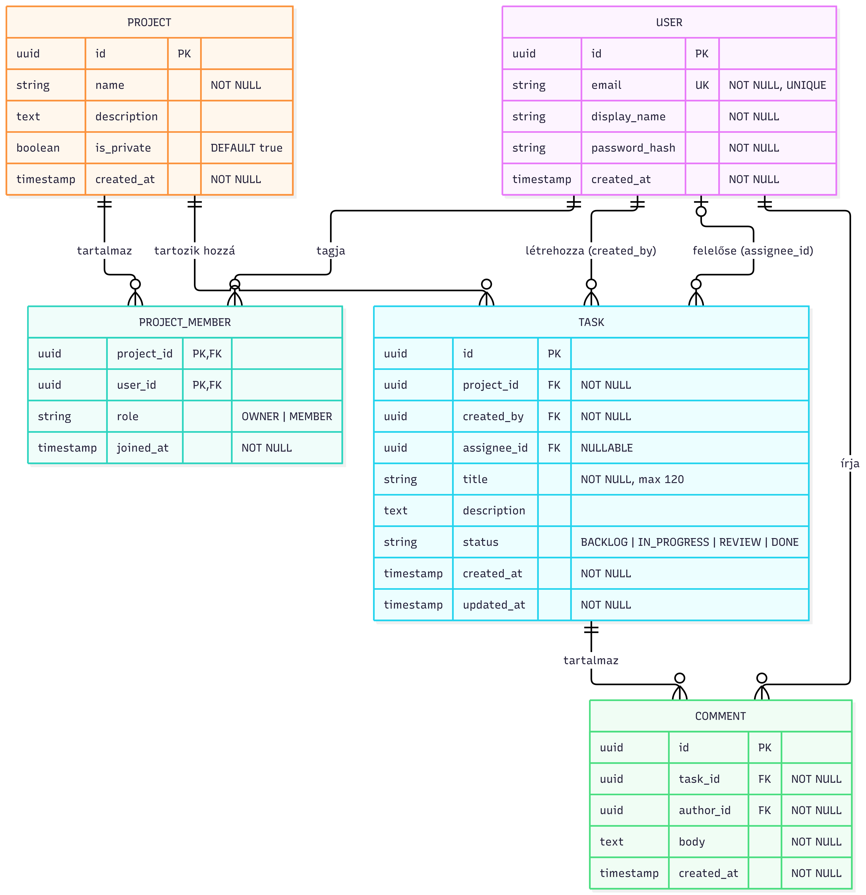

# TaskFlow – Adatmodell és Üzleti Szabályok

## 1. Use Case-ekhez rendelt üzleti szabályok

* **UC-01 / US-01 – Feladat létrehozása:**
    * Csak a projekt aktív tagja (`PROJECT_MEMBER`) hozhat létre feladatot az adott projektben.
    * A feladat címe (`title`) kötelező, nem lehet üres és legfeljebb 120 karakter hosszú lehet.
    * Új feladat létrehozásakor a kezdő státusz mindig `BACKLOG`.
    * A létrehozó felhasználót (`created_by`) a rendszer automatikusan rögzíti.
* **UC-02 / US-02 – Feladat státuszának módosítása:**
    * Csak projekt tag módosíthat státuszt.
    * Megengedett státuszértékek: `BACKLOG`, `IN_PROGRESS`, `REVIEW`, `DONE`.
    * Érvénytelen státuszváltás esetén az állapot nem módosul (atomi tranzakció).
* **UC-03 / US-04 – Felelős hozzárendelése (`assignee_id`):**
    * A felelős mező opcionális (`NULL` megengedett).
    * Ha ki van töltve, a kijelölt felhasználónak szintén az adott projekt tagjának kell lennie.
* **UC-04 / US-07 – Projekt tagság kezelése:**
    * Egy felhasználó egy projektben csak egyszer szerepelhet (`(project_id, user_id)` összetett elsődleges kulcs).
    * Szerepkörök (`role`): `OWNER` (projekt és tagok kezelése) vagy `MEMBER` (feladatok kezelése).

## 2. Entity-Relationship Diagram (ERD)

*Szerkeszthető forrás:* [`erd.mmd`](erd.mmd)

## 3. Adatbázis kényszerek (Constraints) összefoglaló

| Tábla | Oszlop / Kulcs | Kényszer (Constraint) | Indoklás |
| :--- | :--- | :--- | :--- |
| `USER` | `email` | `UNIQUE, NOT NULL` | Egyedi felhasználói azonosítás belépéshez. |
| `PROJECT_MEMBER` | `(project_id, user_id)` | `PRIMARY KEY` | Ne lehessen ugyanazt a tagot kétszer felvenni egy projektbe. |
| `TASK` | `project_id` | `FOREIGN KEY, NOT NULL` | Minden feladatnak tartoznia kell egy projekthez. |
| `TASK` | `title` | `NOT NULL, CHECK (length <= 120)` | Üres című feladat ne jöhessen létre. |
| `TASK` | `status` | `NOT NULL, DEFAULT 'BACKLOG'` | Egységes munkafolyamat-állapotok biztosítása. |